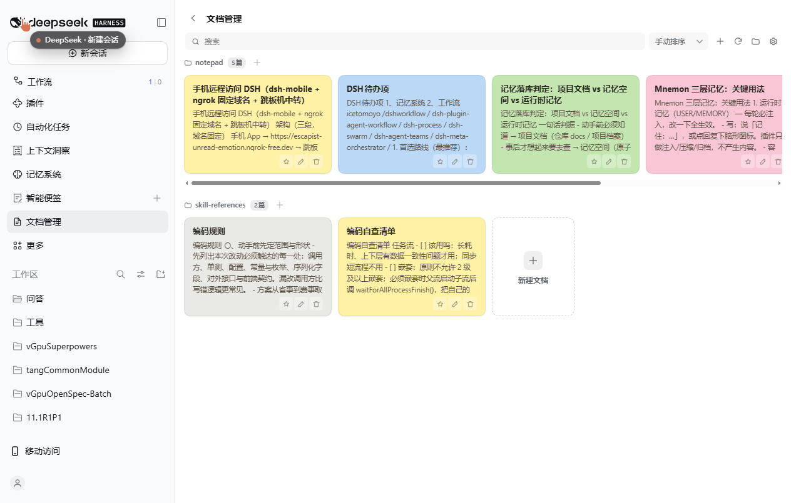
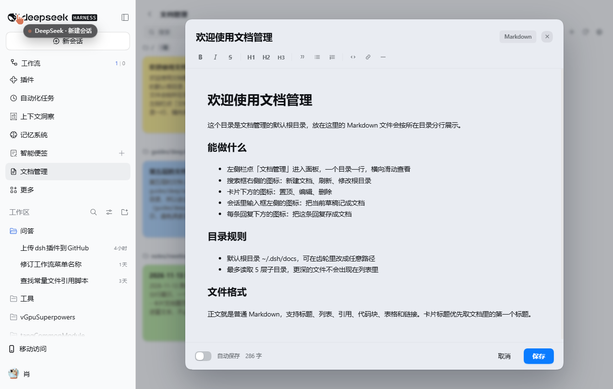
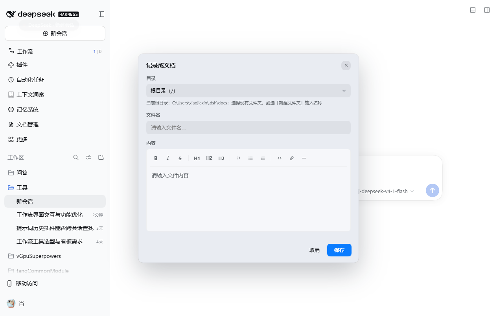
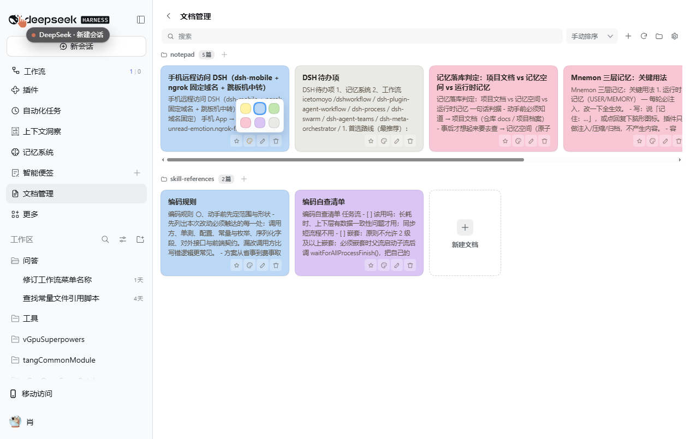

# dsh-docs-manager

A DeepSeek Harness plugin that turns a folder of Markdown files into a card wall inside the app: one row per directory, one card per document, with create / edit / delete / pin / sort and one-click capture from a conversation.



## What it does

- **Sidebar entry** — a 【文档管理 / Documents】 item in the left sidebar opens the panel in the main content area; the `‹` next to the title goes back to the conversation.
- **One row per directory** — documents under the root are grouped by their folder; each group is a single horizontal row of cards that scrolls sideways when a folder holds more cards than fit. A search box on the toolbar filters by file name, path, title or body excerpt.
- **Recursive scan, depth-limited** — reads `.md` / `.markdown` files up to 5 directory levels below the configured root.
- **Rich-text editing** — clicking a card opens the editor directly (no separate read-only page). The body is a WYSIWYG `contenteditable` area; the toolbar offers bold, italic, strikethrough, H1–H3, quote, bulleted/numbered lists, code, link and horizontal rule, and the header toggles between Markdown source and formatted view.
- **Titles come from the document** — the card title is the document's first heading when it has one, otherwise the file name. Editing the title rewrites that heading line; if the file has no heading, the file is renamed on disk.
- **Colors are stable** — each card gets a sticky-note color (yellow / blue / green / pink / purple / gray) hashed from its path, so sorting or dragging never changes colors. The palette button on a card lets you pick another color; picking the current one again restores the automatic color.
- **Pin and sort** — pinning keeps a card first inside its own directory. The toolbar's sort dropdown switches between name (Chinese by pinyin), last-modified, and manual ordering, where cards can be dragged within their row.
- **Capture from chat** — an icon at the left of the composer saves the current draft as a new document, and an icon under each assistant reply saves that reply's text with a derived title. The capture card floats over the page (no full-screen dimming), uses the same folder picker and rich-text editor as the new-document dialog, and writes Markdown.
- **Configurable root** — defaults to `~/.dsh/docs`; the gear next to the search box changes it to any absolute path (or `~`-prefixed). A folder icon opens the current root in the system file manager.
- **Safe paths** — every request is resolved inside the root and restricted to `.md` / `.markdown`; writes are UTF-8 and create parent directories as needed.



## Install

```sh
dsh plugin --profile <profile> add dsh-docs-manager
```

Or install it from the plugin market in the app. After install, restart the app once so the Host half registers its HTTP routes; Client-side changes afterwards only need a page refresh.

## Configuration

| Item | Value |
| --- | --- |
| Default root | `~/.dsh/docs` |
| Config file | `~/.dsh/storages/dsh-docs-manager/config.json` |
| Scan depth | 5 directory levels |
| Accepted files | `.md`, `.markdown` |

Pin / sort / color preferences live in the browser's `localStorage` (`dsh-docs-manager:pinned`, `dsh-docs-manager:order`, `dsh-docs-manager:tones`).

## Host API

The Host half registers `/docs-manager/api/*` on the `webServer` service:

| Path | Method | Body / result |
| --- | --- | --- |
| `/state` | GET | root path plus documents grouped by directory, each with `title` and `excerpt` |
| `/read` | POST | `{ path }` → `{ content }` |
| `/write` | POST | `{ path, content }` → creates or overwrites, creating parent directories |
| `/delete` | POST | `{ path }` |
| `/config` | GET / POST | read or change the root directory |
| `/open-root` | POST | opens the root in the system file manager |

Every request passes the Connection service's Host/Origin checks and browser authentication first (`ctx.connection.requestRejection`), so a web page open in the same browser cannot call these routes.

## Screenshots

| Capture from chat | Card colors |
| --- | --- |
|  |  |

## Known trade-offs

- The panel opens in the main content area rather than the native right sidebar: a plugin tab there only renders its body once a session surface is mounted, so it could not be shown reliably.
- Overlays cover the panel, not the whole window — the desktop window's own title bar would otherwise stay bright next to a dimmed page.
- Styles are injected as the plugin's own `<style>` element instead of the Client's `styles.insert`, which silently does nothing on some versions.

## License

MIT
