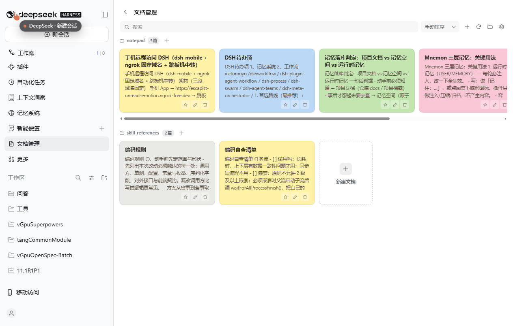
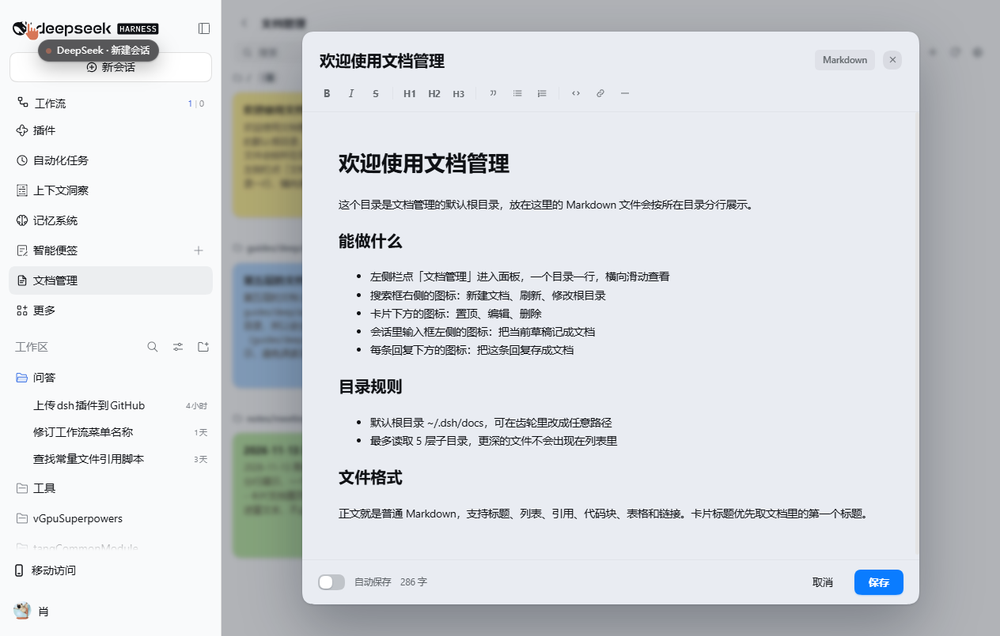

# 文档管理（dsh-docs-manager）

DSH 插件：左侧栏新增【文档管理】入口，点开是一面按目录分行的 Markdown 卡片墙，可新建 / 编辑 / 删除 / 置顶 / 排序，并能把会话里的草稿或回复一键存成文档。



## 能力

- 左侧栏【文档管理】→ 主内容区打开文档面板（标题左边的「‹」返回会话）。
- 卡片墙：一个目录固定一行，卡片横向排列，多了向右滚动；搜索框在标题行右侧，按文件名 / 路径 / 标题 / 摘要过滤。
- 卡片用便签式配色（黄 / 蓝 / 绿 / 粉 / 紫 / 灰），颜色由文档路径哈希决定，所以排序、拖拽不会让它变色；想改就点卡片底部的调色板图标，六色任选，再点一次同色恢复自动配色。手动选的颜色存在 `dsh-docs-manager:tones`（按路径记，改标题即改路径，会回到自动配色）。标题取文档自带的第一个标题，正文摘要取文档正文；卡片底部一排按钮：置顶、调色、编辑、删除。
- 每组标题右侧有「+」、行末有「新建文档」虚线卡片，两处都会把该目录预填进新建弹层；顶部工具栏的「+」默认建在根目录。
- 新建弹层的【目录】是文件夹下拉框：根目录、已有文件夹、或「新建文件夹」（输入 `notes/meeting` 这类相对路径即可）；下方提示当前根目录的实际路径。
- 递归读取根目录下最多 5 层子目录中的 `.md` / `.markdown` 文件。
- 点卡片直接进编辑，不经过只读预览页：正文是所见即所得编辑器，工具栏提供加粗、斜体、删除线、H1–H3、引用、列表、代码、链接、分隔线；右上角可在「Markdown」源码与排版之间切换。
- 标题栏就是文档标题：文档自带一级标题时改的是那个标题行，没有一级标题时改的是文件名（等同改名移动文件）。
- 置顶在该目录内部生效（置顶的卡片排在本目录最前），偏好存在浏览器 `localStorage`（键 `dsh-docs-manager:pinned`）。
- 排序：搜索框右侧的下拉框可切换「按名称」（中文按拼音）/「按更新时间」（新的在前）/「手动排序」；选「手动排序」后卡片可拖拽，同目录内拖动即重排，顺序存在 `dsh-docs-manager:order`。置顶始终排在所属目录最前，与排序方式无关。
- 删除走面板内的二次确认弹层，不用浏览器原生 confirm；自动保存开关可定时静默落盘。
- 会话输入框左下角图标「记一条文档」预填当前草稿；每条回复下方图标「存为文档」预填该回复正文与标题。



## 根目录

默认 `~/.dsh/docs`，在搜索框右侧的齿轮里改成任意绝对路径（或以 `~` 开头）；旁边的文件夹图标会在系统文件管理器里打开当前根目录。
配置保存在 `~/.dsh/storages/dsh-docs-manager/config.json`。

## 接口

Host 半体通过 `webServer` 注册 `/docs-manager/api/*`：

| 路径 | 方法 | 说明 |
| --- | --- | --- |
| `/state` | GET | 根目录 + 按目录分组的文档列表（含 `title` 与 `excerpt`） |
| `/read` | POST | `{ path }` 读文档 |
| `/write` | POST | `{ path, content }` 新建或覆盖（自动建父目录） |
| `/delete` | POST | `{ path }` 删除 |
| `/config` | GET / POST | 读 / 写根目录 |
| `/open-root` | POST | 在系统文件管理器里打开根目录 |

所有路径解析都限制在根目录内，且只接受 `.md` / `.markdown`；写入统一 UTF-8。

## 安装

```sh
dsh plugin --profile <profile> add dsh-docs-manager
```

也可以在应用内的插件市场里安装。装好后重启一次应用（Host 半体注册接口需要重启），之后 Client 侧改动刷新页面即可生效。

## 已知取舍

- 面板开在主内容区，不走 DSH 原生右栏：右栏的插件 tab 正文要等会话表面挂载完才渲染，未挂载时点开只会得到一个空白 tab，无法稳定呈现。
- 面板内的弹层与编辑器只在面板范围铺遮罩，不盖整窗，避免与桌面窗口标题栏的亮块割裂。
- 样式用插件自建的 `<style>` 节点（内联注入），不用 Client 的 `styles.insert`：后者在部分版本静默不落地。

## 许可

MIT
